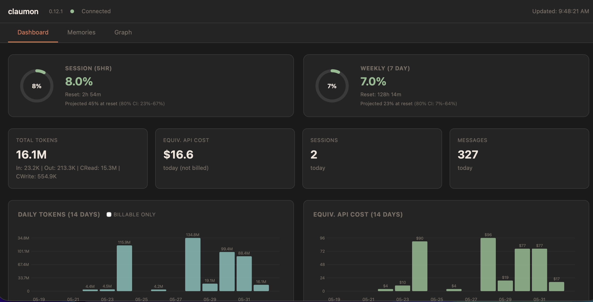
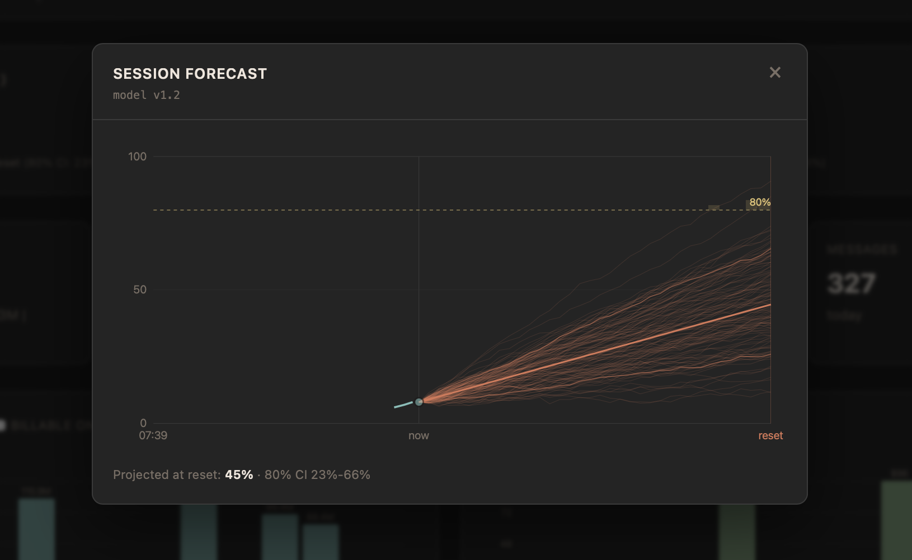

<h1 align="center">
  
</h1>

<div align="center">

[](https://github.com/fabioconcina/claumon/releases/latest)
[](https://github.com/fabioconcina/homebrew-claumon)
[](go.mod)
[](LICENSE)
[](https://github.com/fabioconcina/claumon/releases/latest)
[](https://github.com/hesreallyhim/awesome-claude-code)

</div>

**See where your Claude Code limits are headed before you hit them - and manage everything Claude Code leaves on your machine.**

Works with any `claude /login` plan: Pro, Max, or a Team/Enterprise seat. Forecasts come from a published, benchmarked statistical model, not a burn-rate guess. Single binary, zero config, one browser tab. Runs on macOS, Linux, and Windows.

## Why claumon?

Anthropic's usage analytics dashboard is for Team and Enterprise org admins; it is [not available to individual Pro or Max plans](https://support.claude.com/en/articles/12157520), and even for admins it is org-level analytics, not a live view of your own machine. What you get personally (`/usage`, the claude.ai usage page) shows where you stand right now - but no history, no per-session costs, and no idea where you're heading before the limit hits. claumon is that missing personal dashboard, running locally, whatever plan you're on.

What sets it apart:

- **Forecasts you can check.** Projected utilization at reset with an 80% credible interval and ETA-to-threshold, from an empirical-Bayes model refit daily on your own usage history. The model is published ([MODEL.pdf](internal/forecast/MODEL.pdf)) and benchmarked out-of-sample with proper scoring rules - not a burn-rate extrapolation or a percentile heuristic.
- **Live rate-limit gauges.** Session, weekly, and per-model utilization straight from the Claude OAuth usage API - measured, not estimated from logs.
- **Your whole `~/.claude` footprint in one place.** Usage trackers stop at tokens and cost; claumon also manages what Claude Code accumulates on disk - per-session cost breakdowns, historical trends in SQLite, running-process control, and a memory-file browser with health scores, a relationship graph, and recoverable deletion.

Everything updates in real time via SSE, and daily aggregates persist in SQLite so you can track usage over weeks, not just the current session. No Node, no Python, no build step, no config. Run it and open a browser tab.

## How it compares

There are many good usage trackers for Claude Code: statuslines, CLI reporters like [ccusage](https://github.com/ryoppippi/ccusage) (excellent for quick cost reports), menu-bar apps, and other dashboards. Most estimate your limits from local logs. claumon is for keeping a live dashboard open: rate limits measured from the OAuth usage API rather than estimated, forecasts that are calibrated and benchmarked ([spec](internal/forecast/MODEL.pdf)), and your whole `~/.claude` (sessions, costs, memory files) in one place.

<p align="center">
  <br>
  <sub>Live dashboard: rate-limit gauges, token and cost breakdowns, and daily trends over a selectable 7 to 90 day window.</sub>
</p>

<p align="center">
  <br>
  <sub>Session forecast: projected usage at reset with an 80% confidence interval.</sub>
</p>

## Quick start

**Homebrew (macOS / Linux):**

```bash
brew install fabioconcina/claumon/claumon
claumon
```

**Download a prebuilt binary** from [the latest release](https://github.com/fabioconcina/claumon/releases/latest):

```bash
# macOS (Apple Silicon)
curl -Lo claumon https://github.com/fabioconcina/claumon/releases/latest/download/claumon-darwin-arm64
chmod +x claumon
# If blocked by Gatekeeper: right-click -> Open, or run: xattr -d com.apple.quarantine claumon
./claumon

# macOS (Intel)
curl -Lo claumon https://github.com/fabioconcina/claumon/releases/latest/download/claumon-darwin-amd64
chmod +x claumon
# If blocked by Gatekeeper: right-click -> Open, or run: xattr -d com.apple.quarantine claumon
./claumon

# Linux (x86_64)
curl -Lo claumon https://github.com/fabioconcina/claumon/releases/latest/download/claumon-linux-amd64
chmod +x claumon
./claumon

# Windows (x86_64)
# Download claumon-windows-amd64.exe from the releases page
# If blocked by Defender: right-click the .exe -> Properties -> Unblock
# Or run: Unblock-File claumon-windows-amd64.exe
```

**Build from source:**

```bash
go install github.com/fabioconcina/claumon@latest
claumon
```

Open [http://127.0.0.1:3131](http://127.0.0.1:3131) in your browser.

claumon listens on the IPv4 loopback interface only. Session contents, memory
files, and process controls are never exposed to the local network. For access
from another machine, keep claumon on loopback and use an authenticated SSH
tunnel or reverse proxy rather than publishing port 3131 directly.

claumon also refuses requests whose `Host` header isn't `127.0.0.1`,
`localhost`, or `[::1]`, which stops websites from reaching it through DNS
rebinding. An SSH tunnel needs no changes. If your reverse proxy forwards the
browser's original `Host` header, add that hostname to `allowed_hosts` in the
[config](#configuration); otherwise the dashboard answers 403.

claumon reads credentials from `~/.claude/.credentials.json` (created by `claude /login`), or falls back to the OS credential store (macOS Keychain, Linux secret-service via `secret-tool`, Windows Credential Manager) used by the VS Code extension. If credentials are missing, session tracking still works. Only the API usage gauges are unavailable.

### Command-line flags

| Flag | Description |
|------|-------------|
| `--open` | Open the dashboard in your browser on startup |
| `--port` | Override the dashboard port (default from config) |
| `--db` | Override the DB path (e.g. a copy, to run a test instance) |

## Run as a background service

Move the binary somewhere permanent on your `PATH` (e.g. `~/.local/bin`), then:

```bash
claumon service install    # start on login (LaunchAgent, systemd user unit, or Startup folder)
claumon service status     # check if running
claumon service uninstall  # stop and remove
```

No root or admin needed. Per-OS steps and log locations are in [REFERENCE.md](REFERENCE.md#background-service).

## VS Code extension

A companion VS Code extension puts your live usage in the editor status bar and
embeds the dashboard in a panel, so you do not need a browser tab open. The
status bar shows the current percentage and, when a forecast is available, the
projected percentage at reset (e.g. `45%->72% session`); the hover tooltip adds
the session/weekly breakdown, reset times, and the forecast detail.

It is a **client only** and connects to a claumon server you are already running
(default `127.0.0.1:3131`); it does not start or bundle claumon.

Install it from the [VS Code Marketplace](https://marketplace.visualstudio.com/items?itemName=fabioconcina.claumon)
(search for **claumon** in the Extensions view), or from the command line:

```bash
code --install-extension fabioconcina.claumon
```

Each `ext-v*` release also has a `.vsix` for installing without the
Marketplace; see [`extension/`](extension/), where source and build
instructions also live.

## Self-update

```bash
claumon update
```

Checks GitHub releases for a newer version, downloads the right binary for your platform, and replaces the current one. If a background service is installed, it restarts automatically after the update.

Installed with Homebrew? Use `brew update && brew upgrade claumon` instead: `claumon update` detects a Homebrew install and points you there rather than replacing a file Homebrew manages.

When a newer release is out, the dashboard shows a `vX.Y.Z available` badge next to the version; hover it for the update command that fits your install.

Releases ship with checksums, SBOMs and build-provenance attestations; see [Verify a release](REFERENCE.md#verify-a-release).

## Uninstall

Remove the background service (if installed), delete the binary, and optionally remove local data (SQLite database, logs, config, pricing cache).

**macOS / Linux:**

```bash
claumon service uninstall
rm ~/.local/bin/claumon
rm -rf ~/.claumon
```

**Windows (PowerShell):**

```powershell
claumon service uninstall
Remove-Item (Get-Command claumon).Source
Remove-Item -Recurse "$env:USERPROFILE\.claumon"
```

## What it tracks

### Rate limits (live from the Claude API)

- **Session** (5-hour) and **weekly** (7-day) utilization with reset countdowns
- **Per-model** weekly quotas (Fable, Opus, Sonnet, ... - one gauge per model the API reports) and **extra-usage credits**, when applicable
- Gauges color-coded: green (<50%), yellow (50–79%), red (≥80%)

### Forecasts

- **Projected utilization at reset** with an 80% credible interval and ETA-to-threshold for each window, so you see where you'll land before you get there
- An **empirical-Bayes model refit daily** on your own past windows, over a monotone usage process; full spec in [`MODEL.pdf`](internal/forecast/MODEL.pdf) and benchmarked out-of-sample via `claumon bench` (CRPS/pinball, coverage, bias)

### Tokens & cost

- Per-session input / output / cache token breakdowns with **estimated API-equivalent cost**
- **Daily aggregates** with trend charts over a selectable window (7, 14, 30, 60, or 90 days) and a 24-hour activity heatmap

### Sessions & processes

- Active-sessions table (project, model, tokens, cost, messages, last activity) with a today/recent toggle and a full per-message detail view, auto-discovered from `~/.claude/projects/`
- **Running-process detection** with a stop button (SIGINT, conversation preserved on disk)

### Memory tools

- Browser for all memory files (CLAUDE.md, rules, per-project memories) with search, category filters, and staleness indicators
- **Health scores** (A–F per file with improvement tips) and **staleness alerts** (broken MEMORY.md links, orphans, index mismatches)
- Recoverable memory deletion: files move into `~/.claude/.claumon-trash`, can be restored immediately with **Undo**, and are removed permanently after 30 days
- **Trash explorer**: a Trash view in the Memory tab lists recoverable deletions with content preview, original location, time until permanent removal, and one-click restore
- An **interactive relationship graph** with project filters and click-to-navigate; click any file to open it in your editor via `vscode://`

## Keyboard shortcuts

| Key | Action |
|-----|--------|
| `1` `2` `3` | Switch to Dashboard, Memories, Graph tab |
| `/` | Jump to memory search |
| `Esc` | Close session detail panel |

## Configuration

Optional. Create `~/.claumon/config.json`:

```json
{
  "port": 3131,
  "poll_interval_seconds": 120,
  "credentials_path": "~/.claude/.credentials.json",
  "claude_dir": "~/.claude",
  "db_path": "~/.claumon/usage.db",
  "retention_days": 90,
  "stuck_threshold_minutes": 10
}
```

All fields are optional. Defaults are shown above; claumon works without a config file. `retention_days` controls how long usage snapshots and daily aggregates are kept before being pruned. `allowed_hosts` lists extra hostnames claumon answers to besides the loopback ones, for a reverse proxy that keeps the original `Host` header (e.g. `["claumon.example.com"]`). A `pricing_overrides` map can also be set to override per-model pricing, keyed by model ID with `input`, `output`, `cache_read`, `cache_write_5m`, and `cache_write_1h` USD-per-million-token rates.

## How it works

claumon reads the Claude usage API, your session transcripts and memory files under `~/.claude`, and keeps history in a local SQLite database; the dashboard updates live over Server-Sent Events. Everything ships in one binary. Details, data storage and the architecture are in [REFERENCE.md](REFERENCE.md#how-it-works).

## License

MIT
