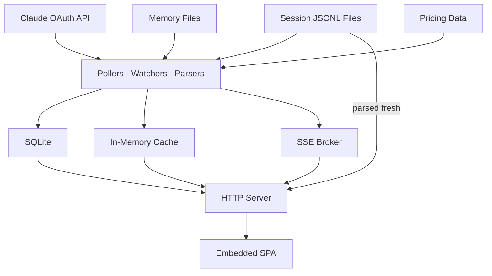

# claumon reference

Details behind the [README](README.md): running claumon as a service, verifying a release, live updates, where data is kept, and how it works.

## Background service

Run claumon automatically on login so the dashboard is always available. First, move the binary to a permanent location, then register the service.

**macOS:**

```bash
mkdir -p ~/.local/bin
mv claumon ~/.local/bin/
# Add to PATH if not already: export PATH="$HOME/.local/bin:$PATH"
claumon service install
```

Creates a LaunchAgent at `~/Library/LaunchAgents/com.claumon.dashboard.plist`. Logs go to `~/.claumon/claumon.log`.

**Linux:**

```bash
mv claumon ~/.local/bin/
claumon service install
```

Creates a systemd user unit at `~/.config/systemd/user/claumon.service`. Logs go to journald (`journalctl --user -u claumon`). By default, systemd user services stop when you log out. To keep claumon running after logout, enable lingering: `loginctl enable-linger $USER`.

**Windows (PowerShell):**

```powershell
# Move the exe to a permanent location
New-Item -ItemType Directory -Force "$env:LOCALAPPDATA\Programs\claumon"
Move-Item claumon-windows-amd64.exe "$env:LOCALAPPDATA\Programs\claumon\claumon.exe"

# Add to PATH (current user, persists across sessions)
$p = [Environment]::GetEnvironmentVariable('Path', 'User')
[Environment]::SetEnvironmentVariable('Path', "$p;$env:LOCALAPPDATA\Programs\claumon", 'User')

# Restart your terminal, then:
claumon service install
```

Adds claumon to the Windows Startup folder - it launches automatically (hidden) on login.

**Manage the service:**

```bash
claumon service status     # check if running
claumon service restart    # restart after config changes
claumon service uninstall  # stop and remove
```

No root or admin required on any platform.

## Verify a release

Every release includes SHA-256 checksums, per-binary SPDX software bills of
materials, and GitHub build-provenance attestations. After downloading a binary,
verify its provenance with the GitHub CLI:

```bash
gh attestation verify ./claumon-darwin-arm64 --repo fabioconcina/claumon
```

The built-in `claumon update` command verifies the downloaded binary against the
release checksum before replacing the current executable.

## Live updates

The dashboard uses Server-Sent Events (SSE) - no polling, no manual refresh. Changes appear instantly:

- **Usage gauges** update every 2 minutes (configurable) from the Claude API
- **Session table** updates when any `.jsonl` session file changes on disk
- **Memory browser** highlights changed files with a visual pulse
- **Graph and staleness** re-render when memory files change on disk

A status dot in the top bar shows connection state (green = connected, red = disconnected).

## Data storage

claumon stores usage snapshots and daily aggregates in a SQLite database at `~/.claumon/usage.db`. Historical data is backfilled automatically on first startup by scanning all existing session files.

The database uses WAL mode for concurrent reads during writes. No maintenance required: data older than 90 days (configurable via `retention_days`) is pruned automatically.

## How it works

claumon combines three data sources:

1. **Claude API** (`/api/oauth/usage`) - polled periodically for rate limit utilization. Requires OAuth credentials from `claude /login`.
2. **Session files** (`~/.claude/projects/*/*.jsonl`) - watched via `fsnotify` for real-time token counting. Each JSONL file is parsed for message-level token usage.
3. **Memory files** (`~/.claude/projects/*/memory/*.md`, `CLAUDE.md`, rules) - discovered and parsed for frontmatter, rendered as HTML, analyzed for cross-references and staleness.

Everything is embedded in a single binary via `//go:embed` - no external files, no Node.js, no build step for the frontend.

### Architecture


